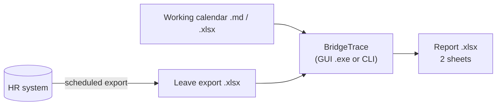
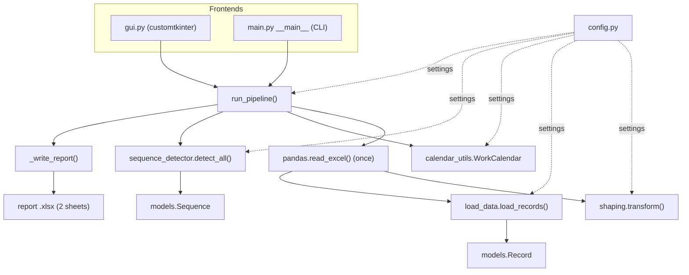
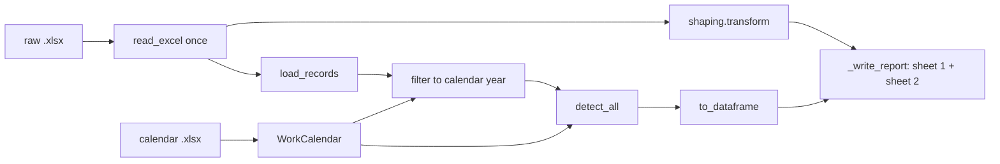
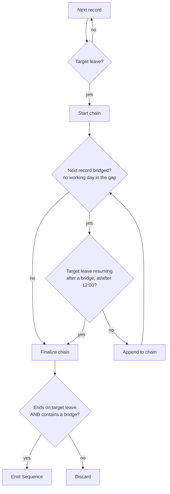

# Architecture

Technical overview of **BridgeTrace**: how the code is organized,
how data flows through it, and why it is shaped this way. Business rules are in
[README.md](README.md).

---

## 1. Purpose in one line

Given a raw Excel leave export and a working-calendar workbook, produce a two-sheet
Excel report: the export shaped like the former manual Power Query, and a list of
**continuous target-leave sequences** (target leave bridged by other leave, weekends,
or holidays).

---

## 2. Context

Everything runs locally: no database, no network, no
credentials. Two `.xlsx` files in, one `.xlsx` file out.

---

## 3. High-level design

A small layered Python application with two front-ends sharing one pipeline.

Design principles:

- **One pipeline, two front-ends.** All real work lives in `run_pipeline()`; GUI and CLI
  only collect inputs, so behavior can never diverge.
- **Pure functions over shared state.** Detection takes plain `Record` objects and a
  `WorkCalendar` and returns `Sequence` objects — no globals, trivially unit-testable.
- **Configuration in one place.** Leave codes, column headers, the AM/PM cutoff, sheet
  and file names all live in `config.py`; business tweaks don't touch logic.
- **Excel in, Excel out.** Every input and output is `.xlsx`.

---

## 4. Modules

| Module | Responsibility |
| ------ | -------------- |
| `config.py` | Single source of truth: target-leave codes, AM/PM cutoff, raw/output headers, calendar columns, code → display text, report/sheet names, shaping column spec, paths. |
| `models.py` | `Record` (one normalized raw row) and `Sequence` (one output row). |
| `load_data.py` | Validates required columns and normalizes rows (codes, dates, times incl. Excel day-fractions); flags target vs. other leave. |
| `shaping.py` | The former Power Query ([scripts/shaping_query.m](scripts/shaping_query.m)) in pandas: select/type columns, add tracking columns, filter target leave, sort. |
| `calendar_utils.py` | `WorkCalendar`: holiday / substitute-working-day sets; answers "is this a working day?". |
| `sequence_detector.py` | Core algorithm: walks each employee's timeline and emits qualifying sequences. |
| `convert_calendar.py` | Converts a human-readable markdown calendar into the `.xlsx` the pipeline reads. |
| `main.py` | Orchestration (`run_pipeline`), report naming, sequence → DataFrame, workbook writer, CLI. |
| `gui.py` | Desktop front-end: step cards, validation, background worker, progress, activity log. |

**Dependency direction:** `gui` / `main` (top) → `shaping`, `load_data`,
`calendar_utils`, `sequence_detector` (middle) → `models`, `config` (bottom). Nothing
below imports a front-end.

---

## 5. Data flow

1. **Read once** — the export is the slowest thing to load, so one DataFrame feeds both sheets.
2. **Shape** — `shaping.transform()` checks columns exist, coerces types like Power
   Query's *Changed Type* (bad values → blank), appends blank tracking columns, keeps
   target-leave rows, stable-sorts newest change first.
3. **Normalize** — `load_records()` builds `Record`s (missing end date → start date).
4. **Calendar** — `WorkCalendar.from_xlsx()` builds `non_working` and
   `substitute_working` date sets; the calendar's year scopes the detection.
5. **Detect** — `detect_all()` groups by employee and emits `Sequence`s (§6).
6. **Write** — openpyxl writes both sheets cell by cell: an Excel table with sort state,
   highlights and date/time formats on sheet 1; wrapped, auto-sized columns on sheet 2.

---

## 6. Core algorithm

Per employee, records are sorted by `(start_date, start_time)` and scanned into chains.

- **Bridged gap** — `WorkCalendar.has_working_day_between()` is false. Substitute
  working days count as worked, so they break the chain.
- **Finalize** — trailing non-target records are trimmed so the chain ends on a target
  leave; it is kept only with ≥ 2 records and at least one bridge (another leave type or
  a non-working gap). A pure `TL → TL` run is excluded.
- **Readable trail** — gaps are labelled `holiday` (calendar-listed) or `weekend`,
  consecutive labels collapsed, and interleaved with leave codes:
  `Sick Leave -> Annual Leave -> Weekend -> Sick Leave`.

Complexity: O(n log n) per employee for the sort plus O(days in gaps) for calendar
checks, using O(1) set lookups — fast for tens of thousands of rows.

---

## 7. Front-ends

- **GUI** — three numbered step cards (export, calendar, output folder), inline
  validation, auto-generated report name, overwrite confirmation, light theme.
  The pipeline runs on a worker thread; log lines and the result go through a
  `queue.Queue` drained by `after()` on the UI thread, because Tk widgets are not
  thread-safe. Friendly message for the common "file is open in Excel" `PermissionError`.
- **CLI** — `python src/main.py [raw.xlsx] [output.xlsx]` with sensible defaults.

---

## 8. Packaging & distribution

PyInstaller one-file, windowed build ([build_exe.spec](build_exe.spec)) so end users need
no Python install. Distribute through an internal file share with a SHA-256 hash of the
`.exe`; unsigned executables may trigger SmartScreen until code-signed.

---

## 9. Testing

pytest, no real data:

- `test_sequences.py` — every include/exclude pattern from the README, plus calendar
  classification (holiday, ordinary weekend, substitute working day).
- `test_report.py` — shaping (column order, types, filter, sort, missing-column error),
  report naming, and end-to-end `run_pipeline` on synthetic workbooks (sheet names,
  table range, number formats, empty-result case).

---

## 10. Key decisions & trade-offs

- **Power Query reproduced in pandas** instead of shipping a workbook with a live query:
  one click, no Excel refresh step; validated row-for-row against the manual result.
- **openpyxl cell-by-cell writing** instead of `DataFrame.to_excel`, because pandas
  writes `datetime.time` as text; openpyxl keeps real Excel times and allows table
  sort state and styling.
- **Year scoping via the calendar** makes the calendar choice the single
  control for the reporting period.
- **Sets for calendar lookups** keep day-by-day gap walking simple and fast.
- **customtkinter** gives a modern look with the standard Tk event model and packages
  cleanly with PyInstaller.
